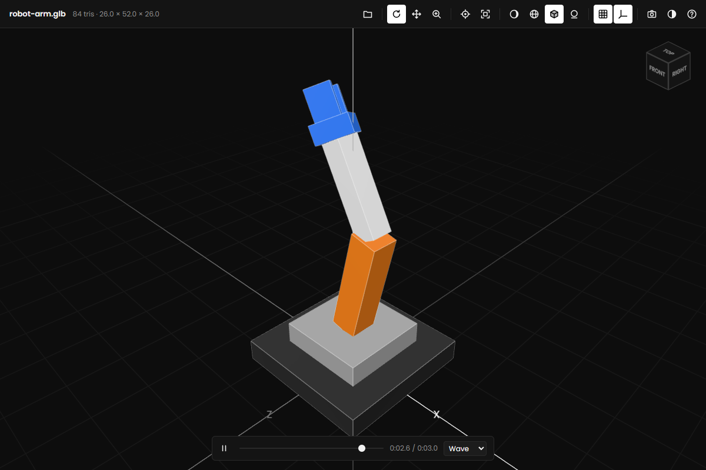
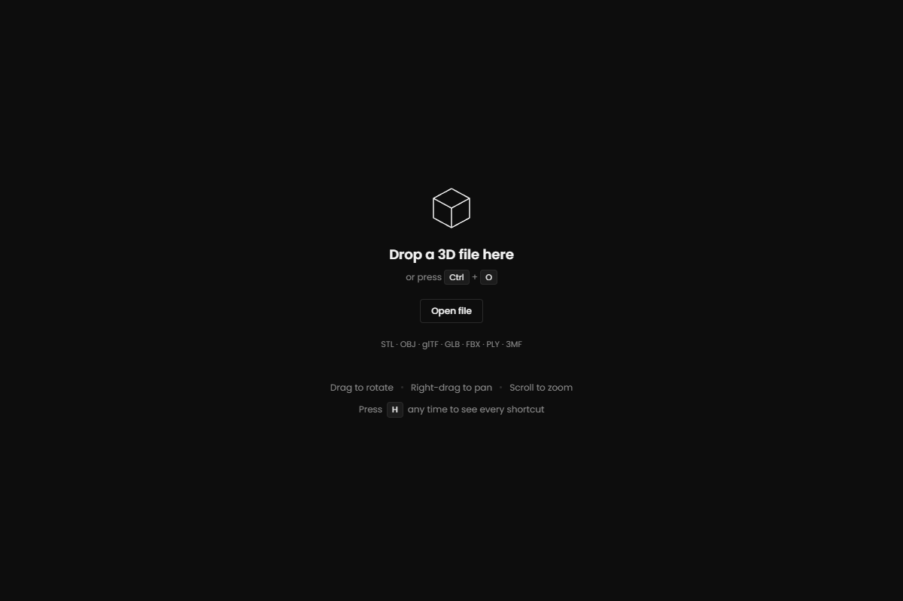
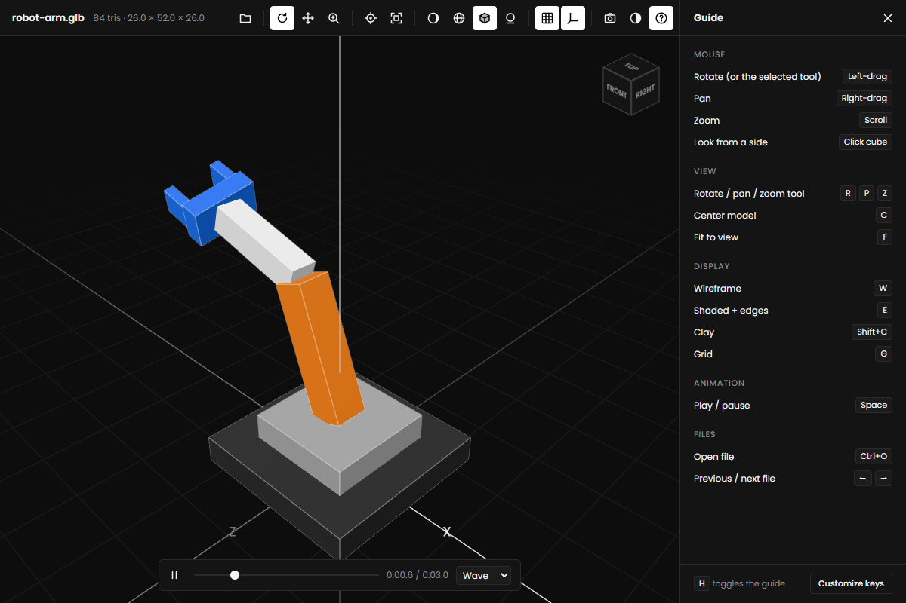
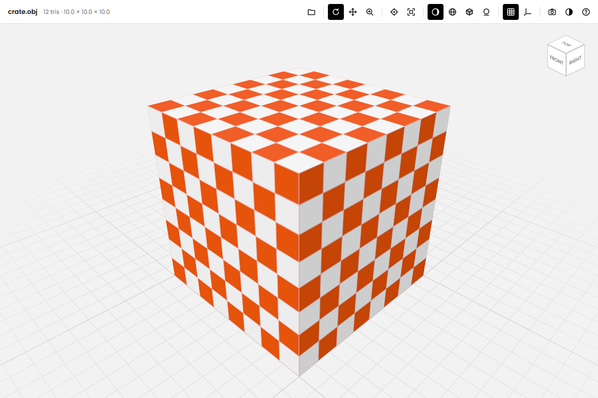

# Lighter

A lightweight 3D viewer for Windows — a replacement for the removed "3D Viewer".
Open a 3D file and look at it: no editing, no accounts, no cloud. About 1.5 MB to install.



| Start screen | Guide panel (H) | Light theme, textured OBJ |
|---|---|---|
|  |  |  |

**[Download the latest release](https://github.com/krakendev35/Lighter/releases/latest)** — run `Lighter_x.y.z_x64-setup.exe`.
The installer isn't code-signed, so Windows may say "Windows protected your PC": choose **More info → Run anyway**.

## Features
- **Formats:** STL, OBJ (+ MTL and textures), glTF / GLB, FBX, PLY (meshes and point clouds), 3MF
- **Open** by double-click / "Open with", drag & drop, or Ctrl+O; one window is reused
- **Textures** next to the model are found automatically, even when the file points at another computer's path
- **View:** rotate / pan / zoom tools, view cube, center, fit to view
- **Display:** shaded, wireframe, shaded + edges, clay; fading grid and axes; dark and light theme
- **Animations** (glTF / FBX): play / pause, timeline, clip picker
- **Screenshot** to PNG, **← →** to step through models in the same folder
- **Guide panel** with every shortcut, and **customisable keys**
- Monochrome UI that stays out of the way: controls appear when you move the mouse

## Controls

| Mouse | |
|---|---|
| Left-drag | Rotate (or the selected tool) |
| Right-drag | Pan |
| Scroll | Zoom |
| Click the view cube | Look from that side |

| Key | Action | Key | Action |
|---|---|---|---|
| R / P / Z | Rotate / pan / zoom tool | W | Wireframe |
| C | Center model | E | Shaded + edges |
| F | Fit to view | Shift+C | Clay |
| H | Guide (all shortcuts) | G | Grid |
| Space | Play / pause animation | ← → | Previous / next file |
| Ctrl+O | Open file | | |

Every key can be changed: press **H**, then **Customize keys**.

## Build from source

Prerequisites: Node.js LTS, [Rust](https://rustup.rs) (MSVC toolchain), Visual Studio Build Tools with "Desktop development with C++". WebView2 is already part of Windows 10/11.

```bash
npm install
npm run tauri dev      # run the desktop app
npm run tauri build    # installers in src-tauri/target/release/bundle/
```